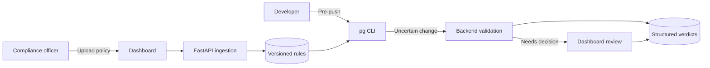

# FerretOPS

FerretOPS turns organizational policies into guardrails that teams can check before code reaches a remote repository. Developers scan changes with the `pg` CLI; uncertain findings go to the backend for validation and, when required, human review. Decisions produce structured verdict records.

## Workflow

## Components

| Component | Purpose |
|---|---|
| `backend/` | Policy ingestion, rule processing, validation, approval flow, and verdict logging. |
| `cli/` | Go pre-push scanner that checks local changes and submits uncertain findings. |
| `frontend/` | Next.js dashboard for policy management and human review. |
| `docs/` | Product roadmap, onboarding, MVP definition, specifications, and workstream handoffs. |

## Project status

The continuous compliance gate MVP is complete and tagged `v0.1.0-mvp`. Current hardening and release work, plus future capabilities, are tracked in the [roadmap](docs/ROADMAP.md). The [MVP definition](docs/mvp/README.md) records its completion criteria.

## Start locally

Read [contributor guidance](docs/CONTRIBUTING.md) for the project workflow and documentation layout.

Read [developer onboarding](docs/ONBOARDING.md) for prerequisites, environment setup, service startup, and the integration workflow. Podman is the default container runtime. For an image-backed local stack, use `podman compose -f docker/docker-compose.yml up --build -d`.

The repository integration command is `./scripts/integration-test.sh`. For local configuration and governance rules, see the [constitution](docs/constitution.md).

## License

MIT. See [LICENSE](LICENSE).
