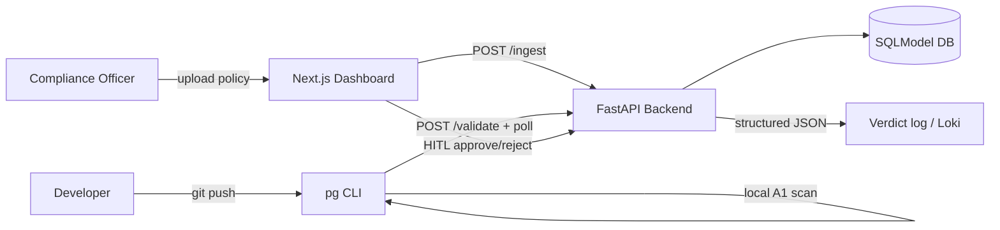

# FerretOPS Roadmap

> **Current status:** The **MVP Continuous Compliance Gate** is complete (`v0.1.0-mvp` on `dev`). Active focus is on post-MVP hardening, packaging automation, and production release promotion.
> **Tracking:** GitHub Project [ComplyAIgent Roadmap](https://github.com/orgs/liitkud/projects/2) · Epic [#74](https://github.com/liitkud/complyaigent/issues/74) · [`docs/mvp/`](mvp/) · [`docs/handoffs/`](handoffs/).

## North star

A compliance officer can **ingest a policy**, a developer’s **pre-push CLI** enforces scannable rules and offloads uncertain diffs to the backend, and the officer can **approve/reject** pending validations on the dashboard — with **structured verdict logs** retained for audit.

## Status snapshot

| Workstream / Capability | Target Phase | Status | Reference / Notes |
|-------------------------|--------------|--------|-------------------|
| CLI ↔ `/validate` polling contract | Phase 0 | Done | PR #64 |
| Lazy LLM client initialization | Phase 0 | Done | PR #63 |
| Integration test payload schemas | Phase 0 | Done | PR #62 |
| Backend CI (`ruff` / `ty` pins) | Phase 0 | Done | PR #73 |
| Policy storage schema & versioning | Phase 1 (MVP) | Done | PR #75, `test_policy_versioning.py` |
| Structured verdict logging & schema | Phase 1 (MVP) | Done | PR #76, `backend/app/core/logging.py` |
| Loki / sink push | Phase 1 (MVP) | Done | PR #77, `backend/app/services/logger.py` |
| Live E2E / HITL dashboard flow | Phase 1 (MVP) | Done | PR #78, Next.js dashboard client |
| Presidio PII gate on `/validate` | Phase 1 (MVP) | Done | PR #79, `backend/app/services/pii.py` |
| A1 regex safety gate (ReDoS prevention) | Phase 1 (MVP) | Done | PR #80, `test_regex_safety.py` |
| Canonical constitution & docs sync | Phase 1 (MVP) | Done | `docs/constitution.md`, PR #82/#83 |
| In-memory manifest cache & token compaction | Phase 2 (Harden) | Done (`dev`) | Issue #14, `BatchEmbeddingCache` |
| Regulatory change simulator (`POST /simulate`) | Phase 2 (Harden) | Done (`dev`) | Issue #13, `test_simulator.py` |
| Load test baseline (<5s SLA) | Phase 2 (Harden) | Done (`dev`) | Issue #22, `backend/scripts/run-load-test.sh` |
| Fedora COPR CLI release packaging | Phase 2 (Harden) | In progress | Spec + SRPM builder in place; secrets pending |
| Contributor PR #88 connection refactor | Phase 2 (Harden) | Planned | Rebase against `dev` pending review |
| Real-time webhooks & vector clustering | Phase 2 (Harden) | Planned | `feat/webhooks-and-vector-clustering` |
| Production promotion (`dev` → `main` / `v0.1.0`) | Phase 2 (Harden) | Planned | Tagging and GHCR publication planned |
| AuditGen (framework evidence packs) | Phase 3 (Operate) | Future | SOC2 / GDPR / PCI-DSS compliance packs |
| Insider threat guardrails | Phase 3 (Operate) | Future | Ephemeral credentials, access anomaly detection |
| Enterprise multi-tenancy & SSO | Phase 3 (Operate) | Future | Multi-tenant isolation, enterprise auth |

## Phases

### Phase 0 — Stabilize (Completed)
Contract alignment, lazy LLM loading, integration test schema fixes, and CI lockfile pinning.

### Phase 1 — MVP Vertical Slice (Completed)
Full continuous compliance gate: policy ingestion with versioning, local CLI scanning, asynchronous `/validate` offloading, live HITL approval, structured verdict logs, PII detection, and ReDoS regex safety (`v0.1.0-mvp`). See [docs/mvp/README.md](mvp/README.md).

### Phase 2 — Harden & Release (Active)
- **Performance & Simulation:** Manifest cache, token compaction, and regulatory drift simulation landed on `dev`.
- **Packaging & Delivery:** Fedora COPR packaging for the CLI (`pg`) and release automation.
- **Integrations:** Contributor PR #88 reconciliation, operational webhooks for HITL escalation, and multi-node vector storage.
- **Production Baseline:** Promoting `dev` to `main` and releasing `v0.1.0`.

### Phase 3 — Operate & Enterprise (Future)
Deploy profiles, audit evidence generators (AuditGen), ephemeral credential guardrails, and enterprise multi-tenant support.

## Non-goals (for MVP)

- Pitch decks / slide design
- AMD-specific swap-in proxy as a deliverable
- Perfect RAG accuracy
- Multi-region / SaaS packaging
